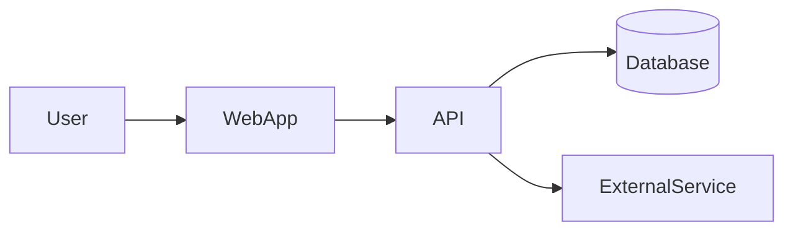

# Architecture

Write `ARCHITECTURE.md`: the map a new contributor (human or agent) reads to find their way around. It answers "where is the thing that does X?" and "what does this part do?" It is a country-level map, not a street atlas. It follows matklad's ARCHITECTURE.md convention: short, stable, and not tied to the code line by line.

## Steps

1. **Read `PRD.md`, `PLAN.md`, `RESEARCH.md`, `CONTEXT.md`, and `docs/adr/`**, and the code if any exists. Name modules and types with CONTEXT.md terms. Every ADR that shapes the structure belongs in the relevant section, cited by number. If PRD.md or PLAN.md is missing, point the user to the `prd` or `plan` skill.
2. **Pick the branch:**
   - **No code yet**: describe the structure the plan will build. Mark the Status line `planned`. Take names for folders, modules, and services from PLAN.md's Files fields, so the map matches what gets built.
   - **Code exists**: describe what is really there, checked against the repo. Wherever the code differs from the plan, the code is the truth. Note each difference under Planned changes.
3. **Write `ARCHITECTURE.md` from the template below.** Keep it short enough to read in one sitting: every recurring contributor reads it. Include only things that rarely change.
4. **Check for gaps against PLAN.md.** If the architecture needs work the plan lacks (a queue, a migration step, an auth middleware), append tasks to PLAN.md with the next free IDs and note them in its Decisions section.
5. **Tell the user** the next step is the `threat-model` skill.

## Writing rules

- **Name** important folders, modules, files, and types in backticks, but don't link them. Readers find them with search, and links go stale.
- **Invariants** are the most valuable section. They are the rules the code must never break, and they are often absences: "the UI never calls the database directly", "only `billing/` talks to Stripe". Agents break rules they can't see.
- Include a diagram when there are more than two moving parts. Use Mermaid, which GitHub renders.
- A new decision that is hard to reverse, would surprise a reader, and came from a real trade-off gets its own ADR in `docs/adr/`. Cite it here instead of arguing the case inline.
- Leave out how individual functions work. That belongs in code comments.

## ARCHITECTURE.md template

````markdown
# Architecture: <project name>

Status: planned | built · Last updated: <YYYY-MM-DD>

## Bird's-eye view
<One or two paragraphs: what the system does and the overall shape of the solution (e.g. "a Next.js web app talking to a Postgres database through a typed API layer, with background jobs on a queue").>

## System diagram


## Codemap
<One entry per important folder or module: what it is responsible for, what it depends on, and the key files or types to search for.>

### `src/app/`
<Responsibility. Depends on: ... Key names: ...>

## Data flow
<How a typical request or user action moves through the system, step by step. Cover the two or three most important flows from PRD.md.>

## Data model
<Main entities and how they relate. Where the schema lives.>

## External services
| Service | Used for | Called from | Credentials |
|---|---|---|---|

## Boundaries
<Where one system ends and another begins: client/server, public API, third-party edges. What crosses each boundary and in what form.>

## Invariants
<Rules that must always hold, one per line, each with a one-line reason.>

## Cross-cutting concerns
<Auth, error handling, logging, configuration and secrets, testing approach, deployment.>

## Planned changes
<Differences between this map and the code or plan that are not built yet. Empty once the Status is built and everything matches.>
````
