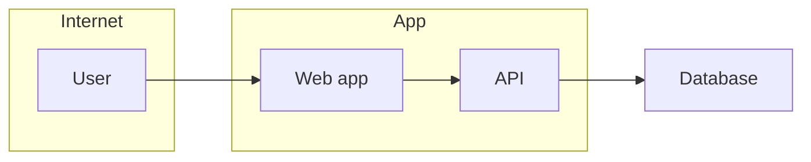

# Threat model

Write `THREAT-MODEL.md`: what is worth attacking in this project, how an attacker would do it, and what stops them. The method adapts OpenAI's `security-threat-model` skill, which focuses on *this* system rather than a generic checklist. The security rules come from Addy Osmani's `security-and-hardening` skill; when that skill is installed, load it for the detailed hardening patterns.

Never name this file `SECURITY.md`. GitHub publishes any `SECURITY.md` in the root, `docs/`, or `.github/` as the repo's public vulnerability-reporting policy. That file belongs to the `security-policy` skill.

## Steps

1. **Read `ARCHITECTURE.md`, `PRD.md`, `RESEARCH.md`, `PLAN.md`, `CONTEXT.md`, and `docs/adr/`**, and the code if any exists. If ARCHITECTURE.md is missing, point the user to the `architecture` skill.
2. **Pick the branch:**
   - **No code yet**: model the *planned* system. Set Status to `planned`. Every claim cites the document section it comes from (`ARCHITECTURE: Boundaries`, `PRD US-7`).
   - **Code exists**: model the *real* system. Every claim cites a repo path and symbol. Where the code differs from ARCHITECTURE.md, the code is the truth.
3. **Build the system model.** List the trust boundaries: every place data crosses from less trusted to more trusted, such as browser→API, API→database, webhooks, third-party APIs, file uploads, and LLM output. For each one, record the data that crosses, the channel, and the auth and validation applied. List the assets (credentials, personal data, payments, admin actions, secrets) and why each one matters.
4. **Define the attacker.** Write down what a realistic attacker *can* do given how exposed the app is (anonymous internet user, logged-in user, malicious tenant) and what they *cannot* do. Stating what's out of reach keeps severities honest.
5. **Enumerate threats.** Walk STRIDE (spoofing, tampering, repudiation, information disclosure, denial of service, elevation of privilege) over each boundary. Write the threats as abuse paths: attacker goal → steps → impact. Keep them specific to this system. A few sharp threats beat a long generic list.
6. **Rank them.** Give each threat a likelihood and an impact (low/medium/high), each with a one-line reason, then a priority (critical/high/medium/low). Note which assumptions drive the ranking most.
7. **Check assumptions with the user before finishing.** List the 3–6 assumptions that most affect the ranking (who can sign up, what data is stored, whether it's multi-tenant, how it's hosted) and ask 1–3 targeted questions. Wait for the answers. Mark anything left unanswered as an assumption.
8. **Write mitigations and rules.** For each critical or high threat: its existing controls, its gaps, concrete mitigations ("rate-limit `/login` by IP and account, 10 per 15 min, shared store"), and how to detect an attack. Then write the Security rules section, tailored to this stack. The `agents-md` skill copies it into AGENTS.md.
9. **Wire it into the plan.** Every mitigation for a critical or high threat needs a PLAN.md task. Append any missing tasks with the next free IDs, note them in PLAN.md's Decisions section, and cite the threat IDs in the Mitigations table.
10. **Check where the file will live.** Run `gh repo view --json visibility` (or ask the user). In a **public** repo, this file hands attackers a map. Ask the user whether to commit it, or to keep it out of git (add it to `.gitignore`) and store it privately. Then tell them the next step is the `security-policy` skill.

## Rules

- Threat IDs are stable: `TM-001`, `TM-002`, and so on. Never renumber them; PLAN.md, PROGRESS.md, and commits refer to them.
- Never write real secrets into the file. Describe where a secret lives, not its value.
- Keep runtime threats separate from build, CI, and dev-tooling threats (dependencies, install scripts, leaked CI secrets). Both are real, but they are different lists.
- If the product calls an LLM, include the LLM-specific threats: prompt injection, model output used as code or queries, secrets or other users' data placed in the prompt, and runaway cost.

## THREAT-MODEL.md template

````markdown
# Threat model: <project name>

Status: planned | built · Last reviewed: <YYYY-MM-DD>
Internal document. Not the public security policy (see SECURITY.md).

## Summary
<One paragraph: the main risk themes and the highest-risk areas.>

## Scope and assumptions
<In scope, out of scope, the assumptions that drive the ranking, and open questions.>

## System model
### Trust boundaries
- **Browser → API**: data <...>; channel <HTTPS>; guarantees <session cookie, CSRF token>; validation <schema at route handler>. Source: <doc section or repo path>

### Diagram


## Assets
| Asset | Why it matters | Protect (C / I / A) |
|---|---|---|

## Attacker model
### Can
### Cannot

## Entry points
| Surface | How it's reached | Boundary | Source |
|---|---|---|---|

## Top abuse paths
1. **<Attacker goal>**: <step> → <step> → <impact>

## Threats
| ID | Threat | Boundary / asset | Likelihood | Impact | Priority | Existing controls | Gaps |
|---|---|---|---|---|---|---|---|
| TM-001 | | | | | | | |

## Mitigations
| Threat | Mitigation | Detection | Plan task |
|---|---|---|---|
| TM-001 | | | P3.T2 |

## Security rules
Copied into AGENTS.md by the `agents-md` skill. Tailor every line to this stack.
### Always
- Validate all external input at the boundary with a schema. <name the library>
- Check authorization on every request: the user must own or be allowed on *this* resource.
- Parameterize every query; never build SQL or shell commands from strings.
- Read secrets from the environment; commit `.env.example` only.
### Ask first
- New auth flows, new categories of personal data, new third-party services, CORS or rate-limit changes, file uploads, new roles or permissions.
### Never
- Commit secrets, log passwords or tokens, trust client-side validation, use `eval` or `innerHTML` with user data, keep auth tokens in `localStorage`, or show stack traces to users.

## Phase checklist
Run at every phase checkpoint (the `progress` skill does this):
- [ ] Dependency audit has no reachable critical or high findings
- [ ] No secrets in code or git history
- [ ] Every new endpoint checks authentication and authorization
- [ ] New inputs validated at the boundary; errors don't leak internals
- [ ] Mitigations planned for this phase are built and tested
- [ ] Any new boundary, asset, or external service is added to this document

## Review log
<Date · what changed · threats added or re-ranked.>
````
